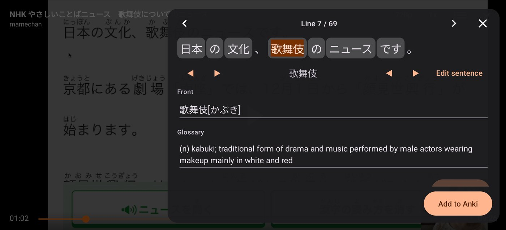

<p align="center"></p>
<h2 align="center"><b>YomiTube</b></h2>
<h4 align="center">Sentence mining from Youtube videos, for Japanese learners.</h4>
<p align="center"><a href="https://github.com/marcuszorian/yomitube/actions/workflows/yomitube-build.yml"></a></p>

> **YomiTube is neither affiliated with nor endorsed by TeamNewPipe or NewPipe e.V.**
> It is an independent fork of [NewPipe](https://github.com/TeamNewPipe/NewPipe).
> Builds of YomiTube are not official NewPipe releases and are not compatible with them.
> YomiTube releases are unofficial, not built by TeamNewPipe, and can't update or be updated by NewPipe.

<p align="center"></p>
<p align="center"><sub>Video shown to illustrate the app: <a href="https://www.youtube.com/watch?v=JI53WTfMErs">「NHK やさしいことばニュース　歌舞伎についてのニュース」</a> by mamechan.</sub></p>

## What it adds

While a video plays, hold on a Japanese caption (or tap the mining button) to open a panel on that line:

- the sentence is split into words; tap one to look it up in a built-in Japanese–English dictionary
- the reading is added as furigana
- trim the sentence audio and preview it
- a screenshot of the video is captured
- **Add to Anki** creates a note in [AnkiDroid](https://github.com/ankidroid/Anki-Android) with the word, reading, meaning, sentence, picture and sentence audio

Captions come from the video's own Japanese subtitles (manual or auto-generated). Audio clips are cut from what the player has already downloaded where possible.

Set the AnkiDroid note type and deck under **Settings → Sentence mining**.

## Download

Get the APK from [**Releases**](https://github.com/marcuszorian/yomitube/releases). Each release lists the NewPipe version it's based on, the dictionary version, and the APK's SHA-256 so you can check the download. YomiTube installs beside NewPipe as its own app; later releases update it in place.

Every push to `mining` also builds a test APK, available for 30 days from the [build workflow](https://github.com/marcuszorian/yomitube/actions/workflows/yomitube-build.yml) (open a run, then **Artifacts**). It installs as a separate app ("YomiTube mining", ID `org.schabi.newpipe.continuous.mining`) and doesn't update the release.

## Building

```
python3 mining/tools/build_jmdict.py   # downloads the latest JMdict, writes mining/src/main/assets/jmdict.db
python3 mining/tools/check_jmdict.py   # optional sanity check
./gradlew assembleDebug
```

The mining feature lives in the `:mining` module; changes to NewPipe's own code are a few small hooks marked "Mining fork". YomiTube's icons and app-facing strings are in `app/src/fork/res`; after merging upstream, regenerate the strings with `python3 -I app/src/fork/make_strings.py app/src`.

Continuous integration: `.github/workflows/yomitube-*.yml` builds every push, publishes a signed release when a `v<NewPipe version>-yt.<n>` tag is pushed, and checks daily for new NewPipe releases (merged automatically when they build cleanly) and new JMdict releases. Upstream NewPipe's own workflows are disabled in this repository.

## Credits and licences

- Based on [NewPipe](https://github.com/TeamNewPipe/NewPipe) by Team NewPipe, licensed under the [GNU GPL v3](LICENSE). YomiTube is distributed under the same licence; this repository is its source.
- Dictionary data: [JMdict](https://www.edrdg.org/wiki/index.php/JMdict-EDICT_Dictionary_Project), © the Electronic Dictionary Research and Development Group, used under [CC BY-SA 4.0](https://www.edrdg.org/edrdg/licence.html), converted with [jmdict-simplified](https://github.com/scriptin/jmdict-simplified).
- Word splitting: [Kuromoji](https://github.com/atilika/kuromoji) (Apache License 2.0) with the IPADIC dictionary; full notices are in the app under Settings → Sentence mining → Sources and licences.
- [AnkiDroid API](https://github.com/ankidroid/Anki-Android/tree/main/api) (LGPL v3).

"NewPipe" is a registered trademark of NewPipe e.V. YouTube is a trademark of Google LLC.
